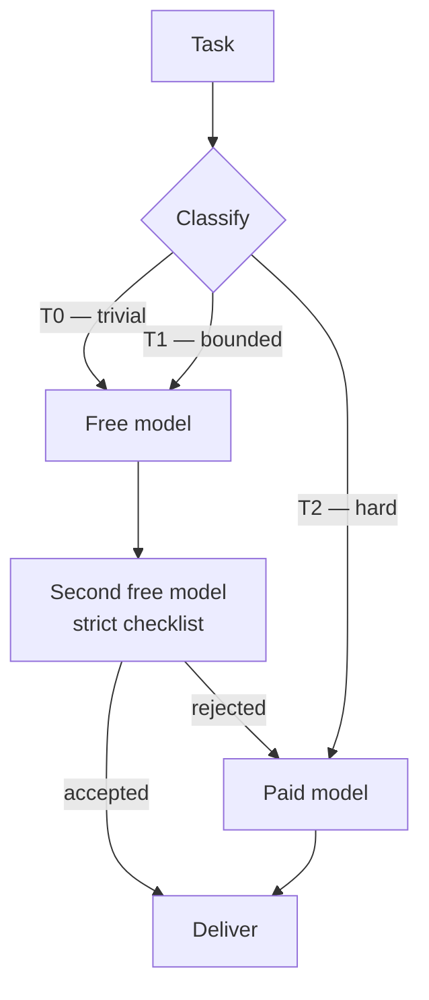

# frugal-agents

**Cut LLM agent costs by 40–70% without losing quality: route easy work to free models, keep the paid model for decisions and review.**

[](LICENSE)
[](https://www.python.org/)
[](https://modelcontextprotocol.io)
[](#quickstart)
[](CONTRIBUTING.md)

Most agent traffic is not hard. Commit messages, summaries, docstrings, regexes, boilerplate, isolated refactors, test scaffolding — a fast free model handles them as well as an expensive one. Paying a frontier model to write them is pure waste.

`frugal-agents` is a **cascade router for coding agents**. A free model produces, a second free model reviews against a strict checklist, and only rejected work escalates to the paid model. The paid model spends its tokens where it is actually better: ambiguous requirements, architecture, production debugging, security, and final review.

This repository contains the research, the playbook of failure modes, and a working **zero-dependency MCP server** that plugs into Codex CLI, Claude Code, or any MCP client.

---

## The idea in one picture



Three properties make this safe:

1. **Generator ≠ judge.** A different model catches defects that self-review misses (the AutoMix finding).
2. **Escalation carries evidence.** The paid model receives the task, the free answer, and the judge's issues — not the whole transcript.
3. **T2 never leaves the paid model.** Anything ambiguous, security-sensitive, or production-bound goes straight to the expensive tier.

---

## What the research says

| Work | Mechanism | Reported result |
|---|---|---|
| [FrugalGPT](https://arxiv.org/abs/2305.05176) (Stanford) | cheap → expensive cascade with a quality scorer | **50–98% cost reduction** at the best model's accuracy |
| [RouteLLM](https://github.com/lm-sys/RouteLLM) (LMSYS) | classifier routes easy queries to a weak model | **>85% cheaper** than all-GPT-4, ~95% quality |
| AutoMix / cascade routing (2025–26) | generate, self-verify, escalate | **97–99%** of the strong model's accuracy |
| Cluster, Route, Escalate ([arXiv 2606.27457](https://arxiv.org/abs/2606.27457)) | cluster queries, pick a cost-effective model per cluster | 97–99% retention with large cuts |
| Gateway pattern (OpenRouter / LiteLLM) | price, latency, health, fallback in one layer | 85%+ cuts with classifier routing |

The honest caveats, which shape the design in [`docs/03-playbook.md`](docs/03-playbook.md):

- A cascade only saves money when the **judge is accurate**. A bad judge pays twice and ships worse code.
- Difficulty classifiers are right **75–85%** of the time. Errors at the margin cost quality.
- Every escalation adds **one sequential generation** of latency.
- Real savings depend on **your task distribution**. Measure before you believe a number.

---

## What's in the box

```
frugal-agents/
├── docs/
│   ├── 01-research.md       literature review, numbers, limitations
│   ├── 02-architecture.md   tiers, cascade, four implementation paths
│   ├── 03-playbook.md       12 failure modes with concrete mitigations
│   └── 04-roadmap.md        phases, acceptance criteria, rollback
└── mcp/free-models/
    ├── server.py            MCP stdio server — Python stdlib only
    ├── codex-config.example.toml
    ├── opencode-config.example.json
    ├── routing-policy.md    drop-in AGENTS.md policy
    └── tests/               unit tests + live smoke test
```

---

## Quickstart

Requirements: Python 3.10+, a free NVIDIA NIM API key from [build.nvidia.com](https://build.nvidia.com), and optionally [OpenCode](https://opencode.ai) for the tool-using worker.

```bash
git clone https://github.com/a32fred/frugal-agents.git
cd frugal-agents/mcp/free-models

export NIM_API_KEY="nvapi-..."          # or: NIM_API_KEY_FILE=~/.secrets/nvidia-key
python3 server.py models                 # show the free model chain
python3 server.py ask "Write a conventional commit message for: add retry with backoff"
python3 server.py cascade "Write a Python slugify() with accent stripping"
```

No dependencies to install, no virtualenv, no daemon.

### Wire it into Codex CLI

Copy [`codex-config.example.toml`](mcp/free-models/codex-config.example.toml) into `~/.codex/config.toml` and fix the path:

```toml
[mcp_servers.free-models]
command = "python3"
args = ["/absolute/path/to/frugal-agents/mcp/free-models/server.py"]
env = { NIM_API_KEY_FILE = "~/.secrets/nvidia-key" }
startup_timeout_sec = 20
tool_timeout_sec = 900
```

Then add the routing policy from [`routing-policy.md`](mcp/free-models/routing-policy.md) to your `AGENTS.md`. Codex calls `free_ask`, `free_agent`, or `free_cascade` instead of generating routine text itself.

### The three tools

| Tool | Use it for | Backend |
|---|---|---|
| `free_ask` | text-only work: commit messages, summaries, regex, docstrings, explanations | NIM `/chat/completions` with fallback chain |
| `free_agent` | work that needs file tools: isolated implementation, tests, small refactor | `opencode run -m nim/<model>` in a chosen directory |
| `free_cascade` | anything you might otherwise send straight to the paid model | free generator + different free judge, returns `escalate_to_paid` |

`free_cascade` output:

```json
{
  "accepted": true,
  "score": 1.0,
  "issues": [],
  "answer": "git log -3 --oneline",
  "generator": "openai/gpt-oss-20b",
  "judge": "google/gemma-4-31b-it",
  "escalate_to_paid": false
}
```

When `escalate_to_paid` is `true`, hand the task, the answer, and the `issues` list to the paid tier. Do not hand over the whole conversation.

---

## Tiering policy

| Tier | Typical work | Executor | Cost |
|---|---|---|---|
| **T0** | commit messages, PR descriptions, summaries, code explanation, regex, docstrings, JSON/YAML, boilerplate, renames, translations | fast free model | $0 |
| **T1** | implementation in an isolated file, tests, spec-driven refactor, step-by-step migration, bug reproduction | strong free model | $0 |
| **T2** | architecture, ambiguous requirements, production debugging, security, design decisions, **final review of anything shipping** | paid model | paid |

The rule behind the table: **the paid model decides and reviews; free models produce volume.**

---

## Safety

- **Redaction before egress.** `free_ask`, `free_cascade`, and `free_agent` strip common credential shapes (`nvapi-`, `sk-`, GitHub tokens, AWS keys, private key blocks, `KEY=value` assignments) before sending anything to a cloud model.
- **No secrets in free prompts.** The routing policy forbids sending `.env` files, customer data, or credentials to free tiers. Redaction is a backstop, not a permission slip.
- **Local-only option.** Point `NIM_BASE_URL` at a self-hosted NIM or Ollama endpoint for zero egress.
- **Ledger.** Every call appends a JSONL record (model, tokens, latency, judge score, escalation) to `~/.frugal-agents/ledger.jsonl`, so savings are measured, not guessed. Disable with `FRUGAL_NO_LEDGER=1`.

---

## Measured expectations (not marketing)

Savings = share of tokens moved to free models × (1 − handoff overhead ≈ 10%).

| Scenario | Displacement | Paid-token reduction |
|---|---|---|
| Conservative — T0 only | 25% | ~20–25% |
| Realistic — T0 + T1, paid review | 50% | ~40–50% |
| Aggressive — cascade + parallel workers + inverted orchestrator | 70% | ~60–70% |

Track your own numbers with the ledger before quoting any of these. The repository ships the measurement, not a promise.

---

## FAQ

**Does Codex support a free model directly?** Codex CLI speaks the Responses API; most free providers expose only `/chat/completions`. That mismatch is why the recommended path delegates through MCP (or a Responses↔Chat proxy). See [`docs/02-architecture.md`](docs/02-architecture.md).

**Does quality drop?** The cascade adds a review the single-model workflow does not have. In the published results, retained accuracy is 97–99% while cost falls sharply. The T2 gate keeps production-bound work on the paid model.

**What if a free model disappears?** The NIM catalog rotates and retired models return HTTP 410. The server keeps a fallback chain, marks failing models unhealthy for a cooldown, and retries a reasoning model with a larger token budget when it returns empty content.

**Is this only for NVIDIA NIM?** No. Any OpenAI-compatible `/chat/completions` endpoint works — set `NIM_BASE_URL`. The defaults and examples use NIM because its free tier is generous.

**Can I use this with Claude Code / other MCP clients?** Yes. It is a standard stdio MCP server with `tools/list` and `tools/call`.

---

## Roadmap

- [x] Research review and failure-mode playbook
- [x] Zero-dependency MCP server (`free_ask`, `free_agent`, `free_cascade`)
- [x] Fallback chain, health cooldown, redaction, JSONL ledger
- [ ] Per-task-type judge checklists and tuned thresholds
- [ ] Parallel worker recipe (paid coordinator + free workers in worktrees)
- [ ] Optional Responses↔Chat proxy profile for Codex
- [ ] Benchmark harness that reports real savings per repository

See [`docs/04-roadmap.md`](docs/04-roadmap.md) for acceptance criteria.

---

## Contributing

Issues and PRs are welcome — especially real-world measurements, judge prompts that reduced escalation rates, and adapters for other free providers. Read [CONTRIBUTING.md](CONTRIBUTING.md) first.

## License

MIT. See [LICENSE](LICENSE).

## Keywords

LLM cost optimization · model routing · cascade inference · FrugalGPT · RouteLLM · AutoMix · token savings · AI agent economics · MCP server · Codex CLI · OpenCode · NVIDIA NIM · free LLM API · generator-critic · multi-model review · prompt caching · agent orchestration
