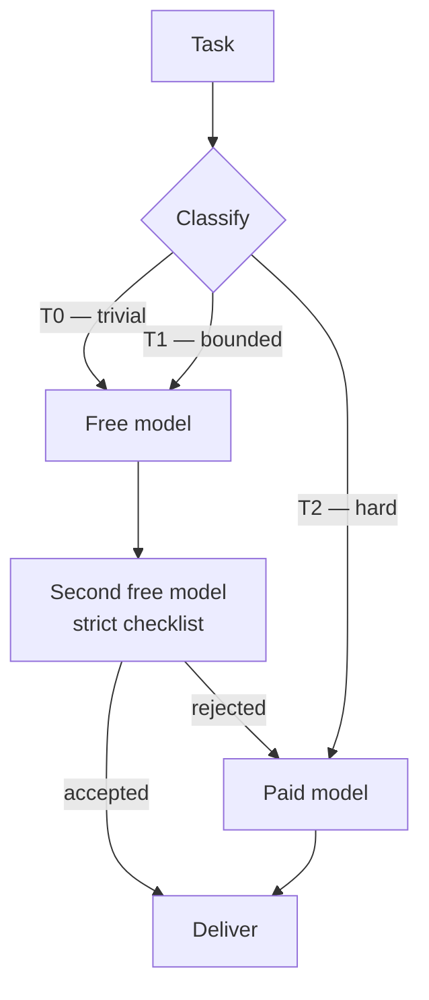

# frugal-agents

**Route easy agent work to free models, keep the paid model for decisions, and measure the savings instead of assuming them.**

[](LICENSE)
[](https://www.python.org/)
[](https://modelcontextprotocol.io)
[](#quickstart)
[](CONTRIBUTING.md)

Most agent traffic is not hard. Commit messages, summaries, docstrings, regexes, boilerplate, isolated refactors, test scaffolding — a fast free model handles them as well as an expensive one. Paying a frontier model to write them is pure waste.

`frugal-agents` is a **cascade router for coding agents**. A free model produces, a second free model reviews against a strict checklist, and only rejected work escalates to the paid model. The paid model spends its tokens where it is actually better: ambiguous requirements, architecture, production debugging, security, and final review.

This repository contains the research, the playbook of failure modes, and a working **zero-dependency MCP server** that plugs into Codex CLI, Claude Code, or any MCP client.

> **Project status: experimental (v0.3.1).** This is a research prototype and reference implementation, not a turnkey product. The server, the judge-independence guard, cancellation, the ledger, the test suite and a free-model quality/judge pilot are real. A **paid savings benchmark has not run**, and only Codex CLI has been tested end-to-end. Read [Status & maturity](#status--maturity) and the [harness compatibility matrix](docs/07-harness-compatibility.md) before deploying it.

---

## The idea in one picture



Three properties keep the trade-off honest:

1. **Generator ≠ judge.** A different model catches defects that self-review misses (the AutoMix finding).
2. **Escalation carries evidence.** The paid model receives the task, the free answer, and the judge's issues — not the whole transcript.
3. **T2 never leaves the paid model.** Anything ambiguous, security-sensitive, or production-bound goes straight to the expensive tier.

---

## What the research says

| Work | Mechanism | Reported result |
|---|---|---|
| [FrugalGPT](https://arxiv.org/abs/2305.05176) (Stanford) | cheap → expensive cascade with a quality scorer | **50–98% cost reduction** at the best model's accuracy |
| [RouteLLM](https://github.com/lm-sys/RouteLLM) (LMSYS) | classifier routes easy queries to a weak model | **>85% cheaper** than all-GPT-4, ~95% quality |
| AutoMix / cascade routing (2025–26) | generate, self-verify, escalate | **97–99%** of the strong model's accuracy |
| Cluster, Route, Escalate ([arXiv 2606.27457](https://arxiv.org/abs/2606.27457)) | cluster queries, pick a cost-effective model per cluster | 97–99% retention with large cuts |
| Gateway pattern (OpenRouter / LiteLLM) | price, latency, health, fallback in one layer | 85%+ cuts with classifier routing |

The honest caveats, which shape the design in [`docs/03-playbook.md`](docs/03-playbook.md):

- A cascade only saves money when the **judge is accurate**. A bad judge pays twice and ships worse code.
- Difficulty classifiers are right **75–85%** of the time. Errors at the margin cost quality.
- Every escalation adds **one sequential generation** of latency.
- Real savings depend on **your task distribution**. Measure before you believe a number.

---

## The other 90%: prompt caching

Routing decides *which* model runs. Caching makes the *same* model cheaper. They stack, and caching requires no quality trade-off.

| Provider | Cache reads | Cache writes | Notes |
|---|---|---|---|
| OpenAI (GPT-5.4+) | **90% off** | none | automatic, ~1K-token minimum, still counts against TPM |
| Anthropic | **90% off** (0.1×) | 1.25× (5 min) / 2× (1 h) | explicit breakpoints, 4 per request |
| Google Gemini | ~75% off implicit | storage per hour | explicit caches bill while they exist |
| DeepSeek | up to ~90% off | none | disk cache, off-peak halves the bill |
| NVIDIA NIM free | $0 | $0 | no billing, latency benefit only |

Two metrics decide whether you actually get the discount:

```text
hit rate  = cached input tokens / total input tokens     # target > 70% in agent loops
write:read = cache writes / cache reads                  # target < 10%
```

The usual killer is a timestamp or a reordered tool list early in the prompt: it turns an 80% saving into 6% without any error message. Read [`docs/06-prompt-caching.md`](docs/06-prompt-caching.md) for the mechanics and [`docs/05-token-glossary.md`](docs/05-token-glossary.md) for every billing term (including why "gold cache" is a TUI color, not a product).

The server normalizes cache and reasoning fields from OpenAI, DeepSeek and Anthropic, then reports them from the ledger:

```bash
python3 server.py stats --days 7
# example output: cache: 812,400/1,204,000 prompt tokens (67.5% hit rate) · write 12,000
```

---

## What's in the box

```
frugal-agents/
├── docs/
│   ├── 01-research.md       literature review, numbers, limitations
│   ├── 02-architecture.md   tiers, cascade, concurrency, four implementation paths
│   ├── 03-playbook.md       13 failure modes with concrete mitigations
│   ├── 04-roadmap.md        phases, acceptance criteria, rollback
│   ├── 05-token-glossary.md billing and architecture terms, provider cheat sheet
│   ├── 06-prompt-caching.md KV cache mechanics, hit-rate math, anti-patterns
│   └── 07-harness-compatibility.md  protocol revisions, client configs, tested/untested matrix
├── bench/
│   ├── README.md            methodology, metrics, reproduction, limitations
│   ├── PREREGISTRATION.md   hypotheses and analysis frozen before the pilot
│   ├── tasks.py             T0/T1/T2 tasks, real mutations, visible tests
│   ├── graders.py           deterministic oracles (no LLM grading)
│   ├── runner.py            free arms, patch insertion, hidden-suite grading
│   ├── report.py            Wilson intervals, judge confusion, Markdown
│   ├── run.py               CLI (--list, --validate-only, run)
│   └── results/             published run artifacts
├── SECURITY.md              threat model, reporting, deployment limits
└── mcp/free-models/
    ├── server.py            MCP stdio server — Python stdlib only
    ├── codex-config.example.toml
    ├── opencode-config.example.json
    ├── routing-policy.md    drop-in AGENTS.md policy
    └── tests/               39 unit tests + live smoke test + official MCP SDK smoke test
```

---

## Quickstart

Requirements: Python 3.10+, a free NVIDIA NIM API key from [build.nvidia.com](https://build.nvidia.com), and optionally [OpenCode](https://opencode.ai) for the tool-using worker.

```bash
git clone https://github.com/a32fred/frugal-agents.git
cd frugal-agents/mcp/free-models

export NIM_API_KEY="nvapi-..."          # or: NIM_API_KEY_FILE=/absolute/path/to/nvidia-key
python3 server.py doctor                 # key, API, catalog, ledger, opencode
python3 server.py models                 # show the free model chain
python3 server.py ask "Write a conventional commit message for: add retry with backoff"
python3 server.py cascade "Write a Python slugify() with accent stripping"
python3 server.py stats                  # escalation rate, cache hit rate, p95 latency
```

No dependencies to install, no virtualenv, no daemon.

### Wire it into Codex CLI

Copy [`codex-config.example.toml`](mcp/free-models/codex-config.example.toml) into `~/.codex/config.toml` and fix the path:

```toml
[mcp_servers.free-models]
command = "python3"
args = ["/absolute/path/to/frugal-agents/mcp/free-models/server.py"]
env = { NIM_API_KEY_FILE = "/absolute/path/to/nvidia-key" }
startup_timeout_sec = 20
tool_timeout_sec = 900
```

Then add the routing policy from [`routing-policy.md`](mcp/free-models/routing-policy.md) to your `AGENTS.md`. Codex calls `free_ask`, `free_agent`, or `free_cascade` instead of generating routine text itself.

> Non-interactive runs (`codex exec`, CI) cannot answer approval prompts. The example config marks the three tools `approval_mode = "approve"` so they run unattended; remove those blocks if you prefer a prompt.

### The three tools

| Tool | Use it for | Backend |
|---|---|---|
| `free_ask` | text-only work: commit messages, summaries, regex, docstrings, explanations | NIM `/chat/completions` with fallback chain |
| `free_agent` | work that needs file tools: isolated implementation, tests, small refactor | `opencode run -m nim/<model>` in a chosen directory |
| `free_cascade` | anything you might otherwise send straight to the paid model | free generator + different free judge, returns `escalate_to_paid` |

`free_cascade` output:

```json
{
  "accepted": true,
  "score": 1.0,
  "issues": [],
  "warnings": [],
  "judge_independent": true,
  "answer": "git log -3 --oneline",
  "generator": "openai/gpt-oss-20b",
  "judge": "google/gemma-4-31b-it",
  "escalate_to_paid": false,
  "usage": {
    "prompt_tokens": 439,
    "completion_tokens": 182,
    "cached_tokens": 0,
    "total_tokens": 621
  }
}
```

`judge_independent` is `false` only when no alternative model exists in the chain. In that case the review still runs, but the result carries a warning; it is not reported as independent evidence.

When `escalate_to_paid` is `true`, hand the task, the answer, and the `issues` list to the paid tier. Do not hand over the whole conversation.

---

## Tiering policy

| Tier | Typical work | Executor | Cost |
|---|---|---|---|
| **T0** | commit messages, PR descriptions, summaries, code explanation, regex, docstrings, JSON/YAML, boilerplate, renames, translations | fast free model | $0 |
| **T1** | implementation in an isolated file, tests, spec-driven refactor, step-by-step migration, bug reproduction | strong free model | $0 |
| **T2** | architecture, ambiguous requirements, production debugging, security, design decisions, **final review of anything shipping** | paid model | paid |

The rule behind the table: **the paid model decides and reviews; free models produce volume.**

---

## Safety

- **Redaction before egress.** `free_ask`, `free_cascade`, and `free_agent` strip common credential shapes (`nvapi-`, `sk-`, GitHub tokens, AWS keys, private key blocks, `KEY=value` assignments) before sending anything to a cloud model.
- **No secrets in free prompts.** The routing policy forbids sending `.env` files, customer data, or credentials to free tiers. Redaction is a backstop, not a permission slip.
- **Task text is not in the process list.** `free_agent` writes the task to the worker's stdin instead of argv; cancelling the MCP request terminates the worker's process group.
- **Local-only option.** Point `NIM_BASE_URL` at a self-hosted NIM or Ollama endpoint for zero egress.
- **Ledger.** Every call appends a JSONL record (model, tokens, latency, judge score, escalation) to `~/.frugal-agents/ledger.jsonl`, so savings are measured, not guessed. Records carry a schema version, are serialized with a file lock across processes, rotate at 10 MB, and never contain prompt or answer text. Disable with `FRUGAL_NO_LEDGER=1`.
- **Known limits.** Redaction is best-effort, the worker is not sandboxed, and the ledger is local observability rather than an audit trail. See [`SECURITY.md`](SECURITY.md).

---

## Expected savings (hypothesis, not a published benchmark)

Published cascades report large savings, but **this repository has not run a paid before/after benchmark on a public task set**. The table below is a hypothesis to test against your own paid-token baseline, not a result.

The free-only pilot in [`bench/`](bench/) measured that precondition and found the free tier strong on routine text and isolated code repair (87% T0, 12/12 T1) but weak on the policy screens (2/8). It does not produce a USD number, because no paid baseline or dated price table has been approved.

Savings = share of tokens moved to free models × (1 − handoff overhead ≈ 10%).

| Scenario | Displacement | Paid-token reduction |
|---|---|---|
| Conservative — T0 only | 25% | ~20–25% |
| Realistic — T0 + T1, paid review | 50% | ~40–50% |
| Aggressive — cascade + parallel workers + inverted orchestrator | 70% | ~60–70% |

Start with Phase 0 of [`docs/04-roadmap.md`](docs/04-roadmap.md): classify one week of real usage, then compare the ledger against that baseline. The repository ships the measurement; it does not yet ship proof for your workload.

---

## FAQ

**Does Codex support a free model directly?** Codex CLI speaks the Responses API; most free providers expose only `/chat/completions`. That mismatch is why the recommended path delegates through MCP (or a Responses↔Chat proxy). See [`docs/02-architecture.md`](docs/02-architecture.md).

**Does quality drop?** The cascade adds a review the single-model workflow does not have. In the published results, retained accuracy is 97–99% while cost falls sharply. The T2 gate keeps production-bound work on the paid model.

**What if a free model disappears?** The NIM catalog rotates and retired models return HTTP 410. The server keeps a fallback chain, marks failing models unhealthy for a cooldown, and retries a reasoning model with a larger token budget when it returns empty content.

**Is this only for NVIDIA NIM?** No. Any OpenAI-compatible `/chat/completions` endpoint works — set `NIM_BASE_URL`. The defaults and examples use NIM because its free tier is generous.

**Can I use this with Claude Code / other MCP clients?** It speaks standard stdio MCP and negotiates protocol revisions from `2024-11-05` through `2025-11-25`. Codex CLI is the only client tested end-to-end. Configuration examples for Claude Code, Cursor, OpenCode, Zed, Cline and Gemini CLI are in [`docs/07-harness-compatibility.md`](docs/07-harness-compatibility.md), but those paths are untested. The stateless `2026-07-28` revision is not implemented yet.

**Does it work on Windows?** Partially and untested. The server is stdlib-only and process cancellation has a Windows fallback, but ledger locking is POSIX-only and CI runs on Linux only. Treat Windows as unsupported until the roadmap's cross-OS gate passes.

---

## Status & maturity

Experimental, pre-1.0. The v0.3.x hardening work removed defects that made unattended use unreliable; it did not add new routing features.

| Area | State | Evidence |
|---|---|---|
| Core tools | working | live Codex CLI call, live cascade, 39 unit tests |
| Judge independence | enforced when the chain has an alternative; otherwise flagged | unit tests |
| MCP lifecycle | threaded; `ping`, progress and `notifications/cancelled`; negotiates `2024-11-05` → `2025-11-25` | concurrency tests, official SDK smoke test |
| Reliability | 429/5xx backoff with jitter, model cooldown, ledger schema/lock/rotation | unit tests |
| Harnesses | Codex CLI tested; other clients documented but untested | [`docs/07-harness-compatibility.md`](docs/07-harness-compatibility.md) |
| Security | redaction and policy; the worker is not sandboxed | [`SECURITY.md`](SECURITY.md) |
| Quality/judge calibration | free-only pilot completed; paid pilot not run | [`bench/`](bench/) |
| Savings | instrumented, not benchmarked | roadmap Phase 0 |

**What v1.0 still requires:**

- A golden-task evaluation set with programmatic oracles and published judge
  precision/recall; the free pilot is the first slice, but it is not a
  human-labeled safety evaluation.
- A paid before/after token and cost benchmark on a reproducible repository,
  with a dated price table and a confidence interval.
- End-to-end tests on at least Codex, Claude Code, Cursor and OpenCode.
- Packaging (`uvx` and Docker) and Windows CI.
- The stateless `2026-07-28` MCP revision, or an explicit decision to stay on the legacy session protocol.

Until then, treat this as a reference implementation: useful, measured locally, and not a drop-in replacement for your paid model.

---

## Roadmap

- [x] Research review and failure-mode playbook
- [x] Zero-dependency MCP server (`free_ask`, `free_agent`, `free_cascade`)
- [x] Fallback chain, health cooldown, redaction, JSONL ledger
- [x] Provider-agnostic cache/reasoning usage normalization and `stats`
- [x] Token glossary and prompt-caching guide
- [x] Hardening: judge guard, threshold fix, stdin task handoff, concurrency/cancellation, backoff, ledger lock/rotation, `doctor`
- [x] Harness compatibility matrix and official MCP SDK smoke test
- [x] Free-model benchmark harness (T0/T1/T2) with deterministic oracles and judge confusion metrics
- [ ] Paid agentic benchmark (all-paid vs routed) and savings report
- [ ] Human-labeled safety evaluation and expanded judge calibration
- [ ] Per-task-type judge checklists and tuned thresholds
- [ ] Parallel worker recipe (paid coordinator + free workers in worktrees)
- [ ] Packaging (`uvx`/Docker) and Windows CI
- [ ] Optional Responses↔Chat proxy profile for Codex

See [`docs/04-roadmap.md`](docs/04-roadmap.md) for acceptance criteria.

---

## Contributing

Issues and PRs are welcome — especially real-world measurements, judge prompts that reduced escalation rates, and adapters for other free providers. Read [CONTRIBUTING.md](CONTRIBUTING.md) first.

## License

MIT. See [LICENSE](LICENSE).

## Keywords

LLM cost optimization · model routing · cascade inference · FrugalGPT · RouteLLM · AutoMix · token savings · AI agent economics · MCP server · Codex CLI · OpenCode · NVIDIA NIM · free LLM API · generator-critic · multi-model review · prompt caching · cached input tokens · KV cache · cache hit rate · reasoning tokens · batch API · token glossary · agent orchestration
